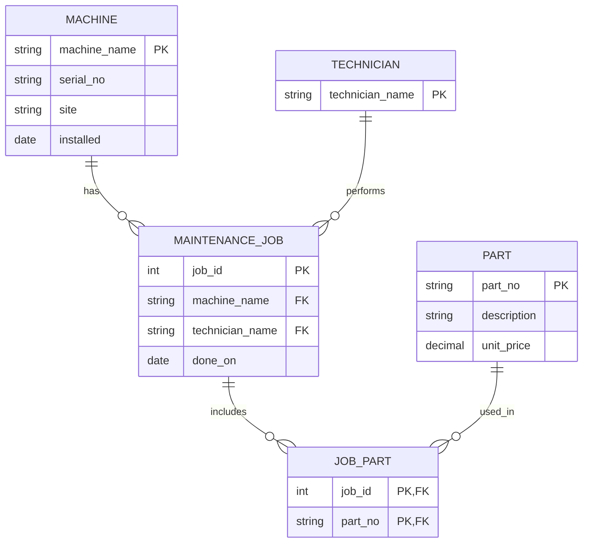

# Task 1: Reconstruct the ER Model

## 1. Entities, Attributes, and Intended Primary Keys

### Machine
- **Attributes:** machine_name, serial_no, site, installed
- **Intended primary key:** machine_name
- Each machine should have a unique name and serial number.

### Part
- **Attributes:** part_no, description, unit_price
- **Intended primary key:** part_no
- Each part should have a unique part number.

### MaintenanceJob
- **Attributes:** job_id, machine_name, technician, done_on, parts_used
- **Intended primary key:** job_id
- Each maintenance job should have a unique ID and refer to one machine and one technician.

### Technician
- **Attributes:** technician_name
- **Intended primary key:** technician_name
- A technician can perform many maintenance jobs.

### JobPart (associative entity)
- **Attributes:** job_id, part_no
- **Intended composite primary key:** (job_id, part_no)
- This entity connects maintenance jobs and parts because one job can use multiple parts and one part can be used in multiple jobs.

## 2. Reconstructed ER Diagram

## 3. Cardinality Findings

The database contains:
- **Machines:** 4 rows
- **Parts:** 4 rows, but only 3 distinct part numbers because P-1003 is duplicated.
- **Maintenance jobs:** 4 rows
- **Jobs using multiple parts:** Job 1 uses P-1001 and P-1002, so at least one job has multiple parts.
- **Invalid machine reference:** Job 3 refers to cnc-05, which is not present in the machine table.

## 4. Relationship Types

- **1:1:** No clear one-to-one relationship is represented by the current data or schema.
- **1:n:** The schema implies that one machine can have many maintenance jobs, and one technician can perform many jobs.
- **m:n:** The relationship between maintenance jobs and parts is hidden inside the comma-separated `parts_used` column. It should be represented by an associative entity such as JobPart.

## 5. Problems in the Legacy Schema

- Primary keys and foreign keys are not declared.
- The part number P-1003 appears twice.
- `unit_price` is stored as text instead of a numeric type.
- `installed` and `done_on` are stored as text without date validation.
- `parts_used` contains multiple values in one column, violating First Normal Form (1NF).
- Job 3 refers to a machine that does not exist.
- The technician is stored as text rather than being represented by a separate entity.
