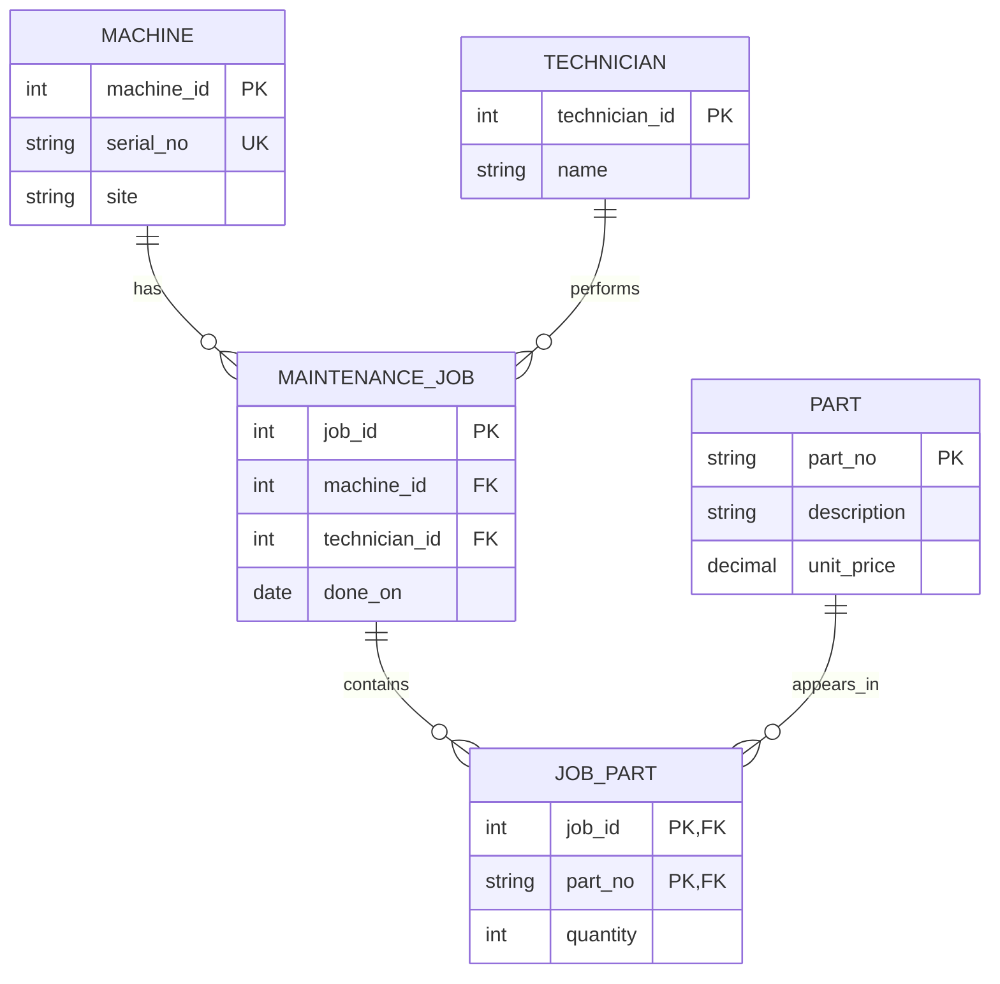
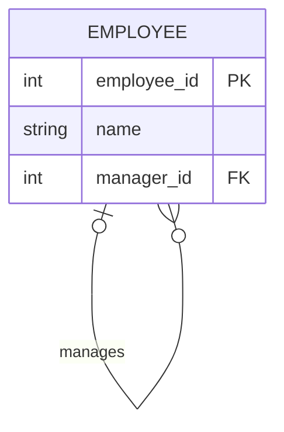
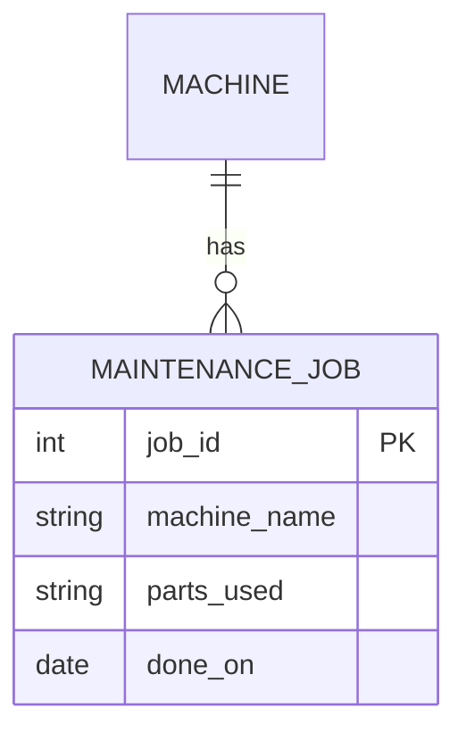
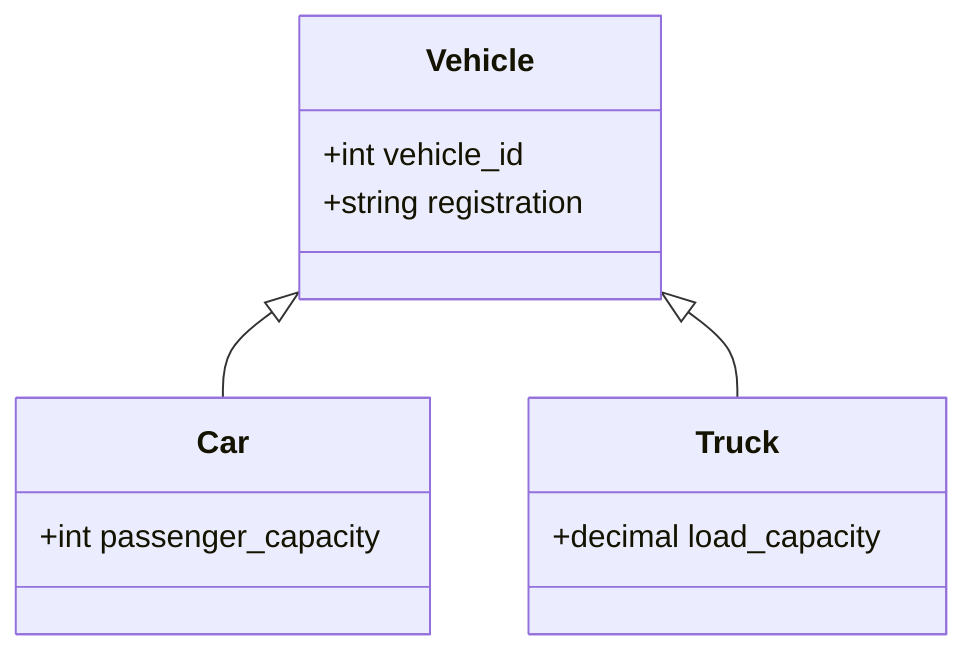

# Task 5: Mermaid ER Diagram Lab

## 1. Three Curated ER Diagrams

### Diagram 1: Good Design — Maintenance System

This diagram is good because it separates machines, maintenance jobs, parts, and technicians into different entities. The `JOB_PART` entity resolves the many-to-many relationship between jobs and parts.

**What it teaches:** A junction table represents a many-to-many relationship and avoids storing several part numbers in one column.

### Diagram 2: Strange Design — Recursive Employee Relationship

An employee can manage other employees. The relationship connects the same entity to itself, which may look unusual but is useful in organizational databases.

**What it teaches:** Recursive relationships allow an entity to relate to other records of the same type. A manager may supervise many employees, while an employee may have zero or one direct manager.

### Diagram 3: Wrong or Confusing Design — Parts Stored in a List

This diagram is confusing because `parts_used` stores several part numbers in one text column. It does not properly represent the relationship between maintenance jobs and parts.

**What is wrong:** The diagram hides the relationship between `MAINTENANCE_JOB` and `PART`. A job containing `P-1001,P-1002` cannot be joined to individual parts reliably. A junction table is the better design.

## 2. Schema-to-Diagram and Diagram-to-Schema

### Schema to Diagram

I used the corrected maintenance schema as the source for the first diagram. The main entities are `MACHINE`, `TECHNICIAN`, `MAINTENANCE_JOB`, `PART`, and `JOB_PART`.

The diagram shows the intended relationships, but the cardinalities must be checked against the schema and actual data. A foreign key can establish a relationship, but it does not prove that every parent has a child or that every parent has multiple children.

### Diagram to Schema

The first diagram can be converted into SQL tables using primary keys, foreign keys, and a junction table. The `JOB_PART` table uses a composite primary key consisting of `job_id` and `part_no`.

After generating the SQL, the schema can be tested in SQLite and inspected with `.schema`.

### Round-Trip Findings

The main entities and relationships can survive a diagram-to-schema round trip when primary keys and foreign keys are explicitly defined. However, a diagram may not preserve every business rule, such as valid dates, positive prices, or the exact number of parts allowed in a job. An AI-generated schema may also invent attributes or constraints that were never present in the original design. Therefore, the generated schema must be checked against the original requirements.

## 3. Cardinality Overuse

Cardinality describes how many instances of one entity can relate to instances of another entity. A car may normally have four wheels, but that number is often a business rule rather than a general relationship cardinality. A car can have a spare wheel, a trailer, or a different wheel configuration. A general one-to-many relationship is more flexible, while a rule requiring exactly four standard wheels can be enforced through application validation or database constraints where appropriate. Exact cardinality is suitable when the rule is genuinely mandatory and stable, rather than merely describing a common situation.

## 4. Inheritance Overuse

### Vehicle Hierarchy

A separate inheritance hierarchy can be useful when different vehicle types have many distinct attributes and behaviors. However, it can become unnecessarily complex when the types differ only by a label or a small number of optional attributes.

For example, a customer may also be an employee and a student. Creating separate inheritance branches for every possible combination can produce complicated tables and duplicate information. A simpler design may use a `PERSON` table with related `CUSTOMER`, `EMPLOYEE`, and `STUDENT` roles, depending on the requirements.

Compared with the machine inheritance exercise, separate subtype tables are useful when subtype-specific attributes are substantial. If the differences are small, a single table with a `type` column and suitable constraints may be simpler.

## 5. Best Find to Share

**My choice:** The maintenance system with the `JOB_PART` junction table.

**Lesson:** A many-to-many relationship should be modeled explicitly instead of hiding several related identifiers inside a text column.

Mermaid source: see Diagram 1 above.
